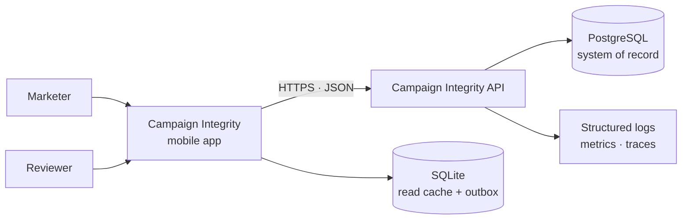
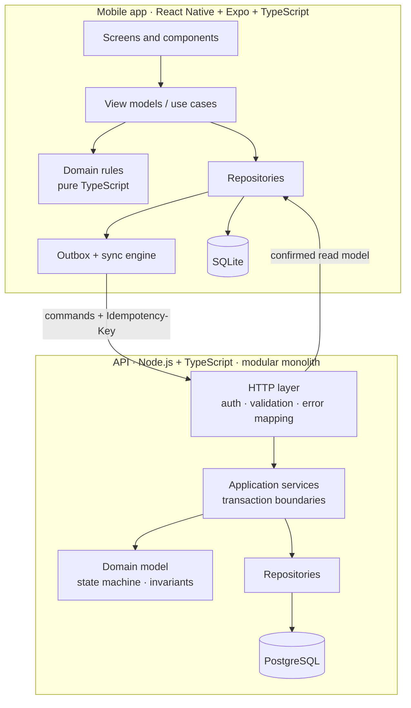
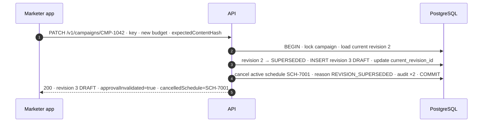
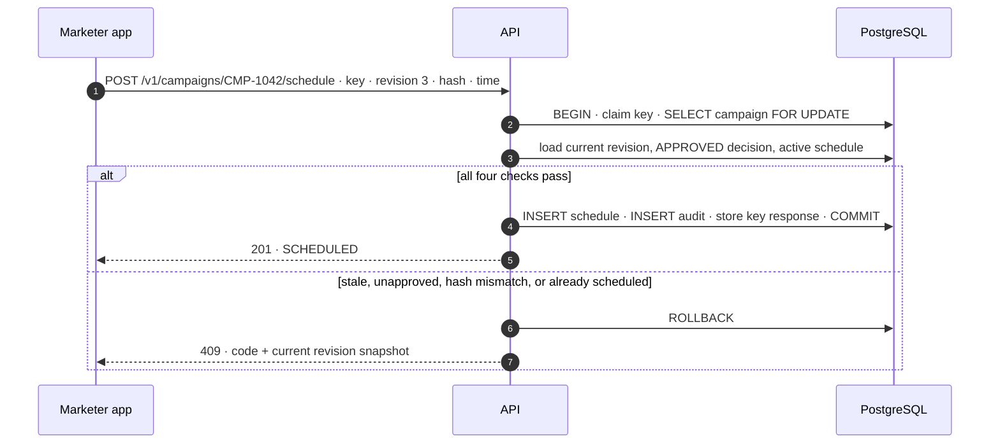
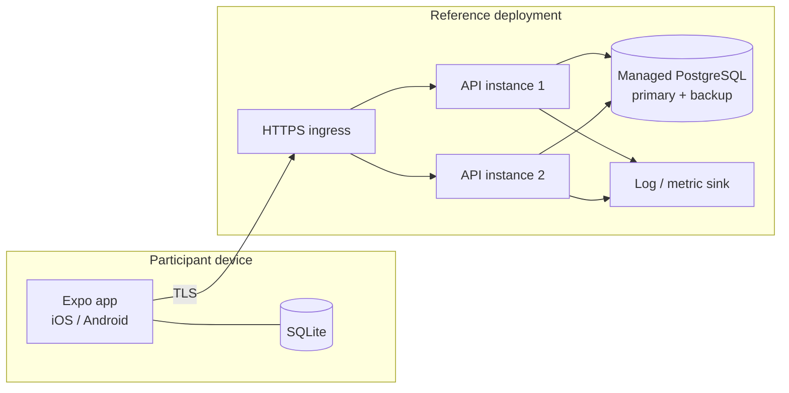

# High-Level Design

**Campaign Integrity — version-aware campaign approval**

This document describes the major components, their responsibilities and dependencies, the main data flows, and the source of truth. It is deliberately small: one mobile app, one API, one database. The complexity is concentrated in one invariant, not spread across infrastructure.

---

## 1. Architectural drivers

| Priority | Driver | What it means here |
|---|---|---|
| 1 | **Integrity** | An unapproved or stale revision must never become schedulable. This is the reason the system exists. |
| 2 | **Recoverability** | A lost response, duplicate tap, app kill, or stale revision must produce a predictable, reconcilable outcome. |
| 3 | **Auditability** | Every committed action must be attributable and must agree with the current state. |
| 4 | **Evolvability** | A realistic change — dual approval above a budget threshold — must be absorbable without redesigning the core. |
| 5 | **Simplicity** | The team must be able to build, explain, and defend every component in one day. |
| 6 | **Performance** | A marketing team’s workload is small. Correctness and clarity outrank throughput. |

The architecture is intentionally optimised for the first three drivers. Performance tactics are present but secondary.

---

## 2. System context



**External systems:** none required. Publishing to ad platforms, creative storage, payments, and notifications are explicitly out of scope. This keeps the boundary honest: the system owns approval and scheduling *eligibility*, not ad delivery.

---

## 3. Container and component view



### Responsibilities

| Component | Owns | Must not |
|---|---|---|
| **Mobile screens** | Rendering, input capture, accessibility labels, confirmation copy | Decide whether a campaign is approved |
| **View models / use cases** | Orchestrating reads, enqueuing commands, exposing UI state | Write directly to SQLite or HTTP |
| **Mobile domain rules** | Pure validation and display helpers (e.g. “is this form complete?”) | Re-implement server eligibility as authority |
| **Repositories (mobile)** | Cache reads, persist outbox rows, hand commands to sync | Invent server state |
| **Outbox + sync engine** | Persist intent before send, retry with the same key, reconcile conflicts | Retry with a new key |
| **HTTP layer** | Authentication, schema validation, idempotency header, error envelope | Contain business rules |
| **Application services** | Transaction boundaries, authorisation, orchestration, audit | Trust client-supplied state |
| **Domain model** | State machine, eligibility predicate, materiality, invariants | Import Express, SQL, or React Native |
| **Repositories (server)** | SQL, row locks, constraint mapping | Decide policy |
| **PostgreSQL** | Durable state, uniqueness, referential integrity, audit rows | Be bypassed by a second writer |

### Dependency rule

```
Presentation → Application → Domain
                    ↑
             Data implements ports
```

- The domain layer imports **nothing** from frameworks, databases, or UI.
- The application layer depends on domain types and repository interfaces.
- The data layer implements those interfaces.
- The mobile app may duplicate *display* rules, but the server is the only authority for transitions and eligibility.

This rule is what makes the critical rule testable without a database, and enforceable without a UI.

---

## 4. Source of truth

| Data | Authoritative store | Client copy | Notes |
|---|---|---|---|
| Campaign, revision, decision, schedule | PostgreSQL | SQLite read cache | Server is the only writer |
| Audit history | PostgreSQL `audit_events` (append-only) | None | Written in the same transaction as the change |
| Pending user intent | Mobile `outbox` | None | Authoritative for “not yet confirmed”, not for domain state |
| Approval validity | **Derived** from current revision + decision + hash | Displayed only | Never stored as a mutable boolean |
| UI status | Server snapshot + pending overlay | SQLite | “Pending” is a client concept, not a server state |
| Logs and metrics | Observability backend | None | Diagnostic evidence, not domain truth |

**The one-sentence version:** PostgreSQL is the system of record; the mobile database is a projection plus a queue of intentions; approval eligibility is computed, never stored.

---

## 5. Major data flows

### 5.1 Create, submit, and decide

```mermaid
sequenceDiagram
  autonumber
  participant M as Marketer app
  participant A as API
  participant D as PostgreSQL

  M->>A: POST /v1/campaigns · Idempotency-Key
  A->>D: BEGIN · claim key · INSERT campaign + revision 1 · audit · COMMIT
  A-->>M: 201 · DRAFT · revision 1

  M->>A: POST /v1/campaigns/CMP-1042/submit · Idempotency-Key
  A->>D: BEGIN · lock campaign · check DRAFT · revision 1 → IN_REVIEW · audit · COMMIT
  A-->>M: 200 · IN_REVIEW

  Note over M,D: Reviewer requests changes; marketer creates revision 2 and resubmits.

  M->>A: POST /v1/campaigns/CMP-1042/decisions · key · revision 2 · APPROVED
  A->>D: BEGIN · lock campaign · check current + IN_REVIEW + hash · INSERT decision · revision 2 → APPROVED · audit · COMMIT
  A-->>M: 200 · APPROVED · decision bound to revision 2
```

### 5.2 Edit an approved or scheduled campaign



The important detail: **the edit and the schedule cancellation are one transaction**. There is no window in which an active schedule points at a superseded revision.

### 5.3 Schedule an approved revision



The four checks are:

1. `request.revisionId = campaign.current_revision_id`
2. `current_revision.state = APPROVED`
3. `decision.revision_id = current_revision.id` and `decision.content_hash = current_revision.content_hash`
4. no `SCHEDULED` row exists for the campaign

They are evaluated **under the same row lock** that serialises edits, approvals, and schedules for that campaign. This is the enforcement point for BR-1 and BR-2.

---

## 6. State ownership

| State | Owner | Client behaviour |
|---|---|---|
| Revision state (`DRAFT`, `IN_REVIEW`, `CHANGES_REQUESTED`, `APPROVED`, `SUPERSEDED`) | Server domain | Mirrors the last confirmed value; never advances it locally |
| Schedule state (`SCHEDULED`, `CANCELLED`) | Server domain | Mirrors the last confirmed value |
| Pending command (`PENDING`, `IN_FLIGHT`, `CONFLICT`, `FAILED`) | Mobile outbox | Shown as an overlay on the confirmed state |
| Approval eligibility | Server domain | Displayed as an action; never trusted from the client |

The mobile app has no code path that sets a campaign to `APPROVED` locally. It can only show **“Confirming approval…”** until the server confirms. This is a deliberate defence against false optimism.

---

## 7. Deployment view



- The API is stateless; any instance can serve any request.
- Correctness does not depend on sticky sessions. The database row lock and unique constraints are the coordination point.
- Migrations run as a separate job before deployment.
- The reference demo can run as a single API container plus PostgreSQL; the architecture does not change.

---

## 8. Security and privacy

| Concern | Design |
|---|---|
| Authentication | OIDC/JWT in production; a signed development token in the prototype. The token carries `sub` and `role`. |
| Authorisation | Role check in the application service, not only the route. Authors own their campaigns; reviewers can decide only on campaigns they did not create. |
| Segregation of duties | `reviewer_id ≠ campaign.created_by`; enforced server-side and covered by a test. |
| Transport | TLS everywhere; certificate validation on the client. |
| Secrets | Environment/secret manager only; no keys in the repository; no AI or third-party keys required for the core. |
| Personal data | Display name and work email only. Audience is a segment description, not a list of people. No end-customer PII. |
| Audit integrity | `audit_events` is insert-only for the application role; updates and deletes are revoked. |
| Input safety | Schema validation, parameterised SQL, length limits, enum checks, canonical hashing. |
| Abuse | Per-user rate limits on commands; idempotency key reuse detection. |
| Threat: stale approval | Current-revision check + content hash + row lock. |
| Threat: replay | Idempotency key + request hash + unique constraints. |
| Threat: unauthorised approval | Role and ownership checks; audit actor. |
| Threat: duplicate schedule | Partial unique index on active schedules. |

Out of scope for v1: SSO, tenant isolation, reviewer assignment, field-level permissions, and encryption at rest beyond the managed database default.

---

## 9. Quality attributes and tactics

| Attribute | Concrete scenario | Tactic | Evidence |
|---|---|---|---|
| **Integrity** | A marketer changes the budget after approval and tries to schedule. | Copy-on-write revision; derived eligibility; single scheduling transaction | T-08, T-11 |
| **Recoverability** | The API commits an approval but the response is lost. | Idempotency key; stored response; reconciliation endpoint; outbox | T-19, T-21 |
| **Concurrency** | Two reviewers or two schedule requests race. | `SELECT … FOR UPDATE` on the campaign row; unique indexes | T-12, T-18 |
| **Auditability** | A judge asks who approved revision 4 and when. | Append-only audit in the same transaction; actor + request ID | T-25, runbook |
| **Evolvability** | Dual approval is required above ₹1,00,000. | Approval policy seam; decisions already support multiple reviewers; schedule join table | `05-walkthroughs/requirement-change.md` |
| **Performance** | Campaign list and detail load quickly. | Indexed reads, pagination, per-campaign locking only | Read-path indexes |
| **Security** | A marketer tries to decide, or a reviewer tries to approve a campaign they created. | Role + ownership check in the service | T-15 |
| **Accessibility** | A screen-reader user reviews a campaign. | Labelled controls, status announcements, 48 dp targets | UI notes in LLD |

---

## 10. Trade-offs and limitations

| Decision | Benefit | Cost | Revisit when |
|---|---|---|---|
| **Server-authoritative, online approvals** | No split-brain; one source of truth; simple conflict handling | Approvals and scheduling need server confirmation; commands may queue offline | Reviewers work in long offline periods |
| **Immutable revisions, every edit re-reviews** | Approval is always bound to exact content; strong audit | More revisions; cosmetic edits cause review fatigue | Review volume becomes a bottleneck |
| **Modular monolith** | One transaction; one deployable; easy to reason about | Less independent scaling | Team or load grows beyond a single service boundary |
| **PostgreSQL** | Row locks, partial unique indexes, transactions, JSONB | Operational dependency | Scale or deployment constraints change |
| **Single approver in v1** | Small scope; clear journey | Not enough for high-budget campaigns | Finance/brand policy requires quorum |
| **Current state + audit table** | Simple reads; full history | No full event replay | Event sourcing or temporal queries become necessary |
| **No creative assets** | Smaller scope; hash covers proposal fields | Cannot approve an image or video | Creative review becomes the core problem |
| **No notifications** | No external dependency | Reviewers must open the queue | Volume requires push/email |

### Known limitations

- No working prototype or measured performance.
- No real ad-platform integration; scheduling is an eligibility record, not delivery.
- No creative asset versioning. If added, the content hash must cover asset IDs and versions.
- No manual schedule cancellation. Editing cancels automatically; a dedicated cancel action is a small future addition.
- Single tenant; no reviewer assignment or delegation.
- The audit table records domain events, not every read or UI action.
- Test results and logs in this pack are illustrative, not captured from a running system.

---

## 11. Optional brownie points — deliberately not claimed

The brief offers optional points for Measure SDK and Gemini 4 Argon. Neither is claimed here, because a mention in a diagram is not a working integration.

If a prototype were built:

- **Measure SDK** would instrument app launch, the approval round-trip, and the schedule command duration. The useful metric is not raw speed; it is the tail latency of the schedule transaction and the time a user spends in “Confirming…”. Before/after evidence would show whether caching the campaign detail reduced time-to-review.
- **Gemini 4 Argon** would power an *advisory* campaign brief summariser or a policy pre-check. It would sit behind an `AiAdvisor` port, return a suggestion with a confidence note, never change approval state, and have a deterministic fallback. The approval invariant would remain entirely outside the model.

Both are extensions, not dependencies. The core design does not need either.

---

## 12. What this design deliberately avoids

- **A stored `is_approved` boolean.** It is the bug, not the fix.
- **Microservices.** The guarantee needs one transaction, not a distributed saga.
- **An event bus or exactly-once messaging.** At this scale, a database transaction and an idempotency table are simpler and stronger.
- **Full event sourcing.** The audit table provides history without the operational cost of rebuilding state.
- **A generic workflow engine.** Two roles and five states do not justify one.
- **Client-authoritative offline sync.** It would make stale approvals a merge problem.
- **A second writer.** Only the API writes domain state.

The next document, [`03-low-level-design.md`](03-low-level-design.md), turns this shape into interfaces, states, schema, and a transaction-level walkthrough.
