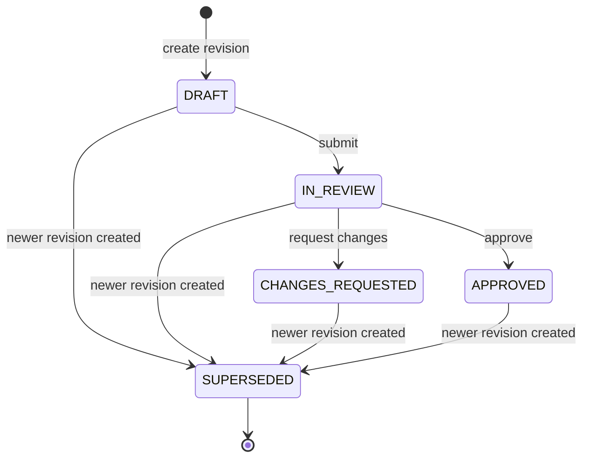

# Low-Level Design and Critical Feature

**Campaign Integrity — modules, interfaces, models, states, and the scheduling transaction**

This document focuses on one critical feature: **revision-aware scheduling**. It defines the domain model, the revision state machine, the ports and adapters, the API contract, the database schema, and the transaction that enforces the core invariant.

The design is implementation-ready but no application code is included.

---

## 1. Module map

The tree is illustrative. It shows boundaries, not a prescribed framework layout.

```
apps/mobile/
  src/
    presentation/
      screens/CampaignListScreen.tsx
      screens/CampaignDetailScreen.tsx
      screens/RevisionEditorScreen.tsx
      screens/ReviewQueueScreen.tsx
      screens/ScheduleScreen.tsx
      components/StatusBadge.tsx
      components/PendingBanner.tsx
      components/ConflictSheet.tsx
    application/
      useCases/CreateCampaign.ts
      useCases/UpdateCampaign.ts
      useCases/SubmitRevision.ts
      useCases/DecideRevision.ts
      useCases/ScheduleCampaign.ts
      useCases/SyncOutbox.ts
    domain/
      campaign.ts
      revision.ts
      approval.ts
      schedule.ts
      eligibility.ts
      errors.ts
    data/
      api/ApiClient.ts
      db/LocalDatabase.ts
      repositories/CampaignRepository.ts
      repositories/OutboxRepository.ts
      sync/SyncEngine.ts
    observability/logger.ts

services/api/
  src/
    http/
      routes/campaigns.ts
      routes/commands.ts
      middleware/auth.ts
      middleware/requestContext.ts
      middleware/errorMapper.ts
    application/
      CampaignService.ts
      ReviewService.ts
      ScheduleService.ts
      IdempotencyService.ts
      CampaignViewService.ts
    domain/
      model.ts
      stateMachine.ts
      eligibility.ts
      contentHash.ts
      errors.ts
    persistence/
      schema.sql
      CampaignRepository.ts
      RevisionRepository.ts
      DecisionRepository.ts
      ScheduleRepository.ts
      AuditRepository.ts
      IdempotencyRepository.ts
    observability/
      logger.ts
      metrics.ts
```

### Boundary rules

| Layer | May import | Must not import |
|---|---|---|
| Mobile presentation | View models, design system | SQLite, HTTP, server code |
| Mobile application | Domain, repository ports | React Native UI components |
| Mobile domain | Nothing but TypeScript | Expo, SQLite, fetch |
| Server HTTP | Application services, schemas | SQL, domain internals |
| Server application | Domain, repository ports | Express request objects |
| Server domain | Nothing but TypeScript | Express, pg, Zod |
| Server persistence | Domain types, SQL driver | HTTP, UI |

The domain layer is pure. The scheduling predicate can be tested with plain objects, without a database or a device.

---

## 2. Domain model

```ts
export type Channel =
  | 'INSTAGRAM'
  | 'EMAIL'
  | 'SEARCH'
  | 'DISPLAY'
  | 'IN_APP';

export type RevisionState =
  | 'DRAFT'
  | 'IN_REVIEW'
  | 'CHANGES_REQUESTED'
  | 'APPROVED'
  | 'SUPERSEDED';

export type DecisionOutcome = 'APPROVED' | 'CHANGES_REQUESTED';

export type ScheduleState = 'SCHEDULED' | 'CANCELLED';

export interface Campaign {
  id: string;
  name: string;                 // display label, not material to approval
  createdBy: string;
  currentRevisionId: string;
  createdAt: string;            // ISO-8601, server clock
  updatedAt: string;
}

export interface CampaignRevision {
  id: string;
  campaignId: string;
  revisionNumber: number;       // 1, 2, 3...
  objective: string;
  audience: string;
  channel: Channel;
  budgetMinor: number;          // integer paise; ₹5,00,000 = 50_000_000
  currency: 'INR';
  contentHash: string;          // 64 lowercase hex characters
  state: RevisionState;
  createdBy: string;
  createdAt: string;
  submittedAt: string | null;
}

export interface ApprovalDecision {
  id: string;
  campaignId: string;
  revisionId: string;
  reviewerId: string;
  outcome: DecisionOutcome;
  reason: string | null;        // required for CHANGES_REQUESTED
  revisionContentHash: string;  // hash at decision time
  decidedAt: string;
  requestId: string;            // trace back to the HTTP request
}

export interface CampaignSchedule {
  id: string;
  campaignId: string;
  revisionId: string;
  approvalDecisionId: string;
  scheduledStartAt: string;
  state: ScheduleState;
  createdBy: string;
  createdAt: string;
  cancelledAt: string | null;
  cancellationReason: 'REVISION_SUPERSEDED' | null;
}
```

### Read model returned to the client

```ts
export type ScheduleEligibility =
  | { allowed: true }
  | {
      allowed: false;
      code:
        | 'REVISION_NOT_CURRENT'
        | 'NOT_APPROVED'
        | 'APPROVAL_HASH_MISMATCH'
        | 'ALREADY_SCHEDULED'
        | 'SCHEDULE_TIME_INVALID';
      message: string;
    };

export interface CampaignView {
  campaign: Campaign;
  currentRevision: CampaignRevision;
  approvalStatus: RevisionState;      // derived from currentRevision.state
  schedule: CampaignSchedule | null;  // active schedule only
  decisions: ApprovalDecision[];      // newest first
  canSchedule: ScheduleEligibility;   // computed server-side
  allowedActions: AllowedAction[];    // computed server-side
}

export type AllowedAction =
  | 'EDIT'
  | 'SUBMIT'
  | 'DECIDE'
  | 'SCHEDULE'
  | 'VIEW_HISTORY';
```

The client renders `allowedActions` and `canSchedule`. It does not infer permission from a status string. This keeps authorisation and eligibility in one place.

### Domain invariants

| ID | Invariant | Enforcement |
|---|---|---|
| **I1** | Exactly one non-superseded revision exists per campaign, and `campaigns.current_revision_id` points to it. | Partial unique index + transaction ordering |
| **I2** | Only the current revision may be `IN_REVIEW`, `CHANGES_REQUESTED`, or `APPROVED`. | Supersede-before-insert; service checks |
| **I3** | An `APPROVED` decision’s `revision_id` and `revision_content_hash` match the revision. | Service check + stored hash + test |
| **I4** | An active schedule references the current revision and its valid approval. | Scheduling transaction + edit transaction |
| **I5** | At most one active schedule exists per campaign. | Partial unique index |
| **I6** | At most one decision exists per reviewer per revision. | Unique index |
| **I7** | Every state change has an audit event written in the same transaction. | Application service + insert-only audit table |
| **I8** | A retried command has exactly one domain effect. | Idempotency key + unique constraints |

### Content hash

The hash is the bridge between “the content” and “the approval”. It must be canonical.

```ts
export interface RevisionContent {
  objective: string;
  audience: string;
  channel: Channel;
  budgetMinor: number;
  currency: 'INR';
}

export function normaliseText(value: string): string {
  return value
    .normalize('NFC')
    .trim()
    .replace(/\s+/g, ' ');
}

export function canonicalise(input: RevisionContent): string {
  // Keys are written in alphabetical order on purpose.
  return JSON.stringify({
    audience: normaliseText(input.audience),
    budgetMinor: input.budgetMinor,
    channel: input.channel,
    currency: input.currency,
    objective: normaliseText(input.objective),
  });
}

export function contentHash(input: RevisionContent): string {
  return sha256Hex(utf8(canonicalise(input))); // 64 lowercase hex chars
}
```

Rules:

- `budgetMinor` is an integer; floating point is never used for money.
- Text is NFC-normalised, trimmed, and internal whitespace is collapsed.
- The campaign `name` is **not** hashed. It is a label, not proposal content.
- Adding a field to the proposal is a deliberate change: it must be added to the canonical object, and existing revisions keep their old hash. The revision row stores the hash, so old approvals remain verifiable.
- The hash is stored on the revision at creation and is immutable. A database trigger rejects updates to `content_hash` on a non-`DRAFT` revision.

---

## 3. Revision state machine



Scheduling is **not** a revision transition. It creates a schedule only when the current revision is already `APPROVED`.

### Transition table

| From | Event | Actor | Guard | To | Side effects | Audit action |
|---|---|---|---|---|---|---|
| — | Create | Author (Marketer or Reviewer) | Valid proposal | `DRAFT` | Revision 1, campaign pointer | `REVISION_CREATED` |
| `DRAFT` | Submit | Author (owner) | Valid, hash matches | `IN_REVIEW` | `submitted_at` set | `REVISION_SUBMITTED` |
| `IN_REVIEW` | Approve | Reviewer (not owner) | Current, hash matches | `APPROVED` | Decision row | `DECISION_APPROVED` |
| `IN_REVIEW` | Request changes | Reviewer (not owner) | Current, reason present | `CHANGES_REQUESTED` | Decision row | `DECISION_CHANGES_REQUESTED` |
| `DRAFT` | Edit | Author (owner) | Hash matches | `DRAFT` | Content updated, hash recomputed | `REVISION_EDITED` |
| `IN_REVIEW` / `CHANGES_REQUESTED` / `APPROVED` | Edit | Author (owner) | Hash matches | old → `SUPERSEDED`; new → `DRAFT` | New revision; pointer update; active schedule cancelled | `REVISION_CREATED`, `SCHEDULE_CANCELLED` |
| any active | Supersede | System | New revision created | `SUPERSEDED` | Terminal | included above |

### Why `CHANGES_REQUESTED` cannot be resubmitted directly

The reviewer’s feedback applies to an exact revision. If the author could resubmit the same revision without a new content hash, the reviewer’s decision would be attached to content that may have changed in place. Requiring a new revision preserves the link between feedback, content, and decision.

### Why `APPROVED` cannot return to `DRAFT`

An approval is historical. Revising an approved campaign creates a **new** revision; the old revision becomes `SUPERSEDED`, while its approval decision remains in history but no longer authorises scheduling. This gives the audit trail a clean story: “Revision 2 was approved; Revision 3 superseded it before scheduling.”

---

## 4. Ports and interfaces

### 4.1 Domain functions (pure)

```ts
export function isCurrentRevision(
  campaign: Campaign,
  revision: CampaignRevision,
): boolean {
  return campaign.currentRevisionId === revision.id;
}

export function isApprovalValid(
  campaign: Campaign,
  revision: CampaignRevision,
  decision: ApprovalDecision | null,
): boolean {
  return (
    decision !== null &&
    decision.outcome === 'APPROVED' &&
    isCurrentRevision(campaign, revision) &&
    decision.revisionId === revision.id &&
    decision.revisionContentHash === revision.contentHash &&
    revision.state === 'APPROVED'
  );
}

export function evaluateScheduleEligibility(input: {
  campaign: Campaign;
  revision: CampaignRevision;
  approval: ApprovalDecision | null;
  activeSchedule: CampaignSchedule | null;
  requestedAt: Date;
  now: Date;
}): ScheduleEligibility {
  if (!isCurrentRevision(input.campaign, input.revision)) {
    return { allowed: false, code: 'REVISION_NOT_CURRENT', message: 'A newer revision is current.' };
  }
  if (input.revision.state !== 'APPROVED') {
    return { allowed: false, code: 'NOT_APPROVED', message: 'The current revision is not approved.' };
  }
  if (!isApprovalValid(input.campaign, input.revision, input.approval)) {
    return { allowed: false, code: 'APPROVAL_HASH_MISMATCH', message: 'The approval does not match the current content.' };
  }
  if (input.activeSchedule !== null) {
    return { allowed: false, code: 'ALREADY_SCHEDULED', message: 'This campaign already has an active schedule.' };
  }
  if (!isValidScheduleTime(input.requestedAt, input.now)) {
    return { allowed: false, code: 'SCHEDULE_TIME_INVALID', message: 'Choose a time at least 5 minutes from now.' };
  }
  return { allowed: true };
}

export function isValidScheduleTime(requestedAt: string, now: Date): boolean {
  const requested = new Date(requestedAt).getTime();
  if (!Number.isFinite(requested)) return false;
  const minimum = now.getTime() + 5 * 60_000;          // at least 5 minutes ahead
  const maximum = now.getTime() + 180 * 24 * 60 * 60_000; // at most 180 days ahead
  return requested >= minimum && requested <= maximum;
}
```

### 4.2 Server application ports

```ts
export interface Clock {
  now(): Date;
}

export interface IdGenerator {
  next(): string; // UUIDv7
}

export interface CampaignRepository {
  getForUpdate(tx: Transaction, id: string): Promise<Campaign | null>;
  get(tx: Transaction, id: string): Promise<Campaign | null>;
  list(tx: Transaction, filter: CampaignFilter): Promise<Page<CampaignSummary>>;
  insert(tx: Transaction, input: NewCampaign): Promise<Campaign>;
  setCurrentRevision(tx: Transaction, campaignId: string, revisionId: string): Promise<void>;
}

export interface RevisionRepository {
  get(tx: Transaction, id: string): Promise<CampaignRevision | null>;
  getCurrent(tx: Transaction, campaignId: string): Promise<CampaignRevision>;
  insert(tx: Transaction, input: NewRevision): Promise<CampaignRevision>;
  updateDraft(tx: Transaction, id: string, patch: RevisionPatch): Promise<CampaignRevision>;
  markSuperseded(tx: Transaction, id: string): Promise<void>;
  setState(tx: Transaction, id: string, state: RevisionState): Promise<void>;
  listForCampaign(tx: Transaction, campaignId: string): Promise<CampaignRevision[]>;
}

export interface DecisionRepository {
  findApproved(tx: Transaction, revisionId: string): Promise<ApprovalDecision | null>;
  listForCampaign(tx: Transaction, campaignId: string): Promise<ApprovalDecision[]>;
  insert(tx: Transaction, input: NewDecision): Promise<ApprovalDecision>;
}

export interface ScheduleRepository {
  findActive(tx: Transaction, campaignId: string): Promise<CampaignSchedule | null>;
  insert(tx: Transaction, input: NewSchedule): Promise<CampaignSchedule>;
  cancel(tx: Transaction, id: string, reason: 'REVISION_SUPERSEDED'): Promise<void>;
}

export interface AuditRepository {
  append(tx: Transaction, event: AuditEvent): Promise<void>;
}

export interface IdempotencyStore {
  claim(tx: Transaction, input: ClaimInput): Promise<ClaimResult>;
  complete(tx: Transaction, claim: Claim, status: number, body: unknown): Promise<void>;
}
```

`getForUpdate` is the only method that issues `SELECT … FOR UPDATE`. Application services must call it before any write that depends on the current revision.

### 4.3 Mobile ports

```ts
export interface CampaignCache {
  getCampaign(id: string): Promise<CampaignView | null>;
  putCampaign(view: CampaignView): Promise<void>;
  listCampaigns(): Promise<CampaignSummary[]>;
}

export interface CommandQueue {
  enqueue(command: PendingCommand): Promise<void>;
  nextBatch(limit: number): Promise<PendingCommand[]>;
  markInFlight(id: string): Promise<void>;
  markDone(id: string, response: unknown): Promise<void>;
  markConflict(id: string, conflict: ApiError): Promise<void>;
  markFailed(id: string, error: string): Promise<void>;
  pendingForCampaign(campaignId: string): Promise<PendingCommand[]>;
}

export interface ApiClient {
  send<T>(command: PendingCommand): Promise<ApiResult<T>>;
  getCommand(key: string): Promise<CommandStatus>;
  getCampaign(id: string): Promise<CampaignView>;
}
```

The mobile `CampaignRepository` composes `CampaignCache` and `ApiClient`. It never exposes a method that sets a revision to `APPROVED`.

---

## 5. Critical feature: revision-aware scheduling

### 5.1 Preconditions

The client may request a schedule only when the server-provided `canSchedule.allowed` is `true`. This is a UX guard, not the guarantee. The guarantee is the server transaction below.

### 5.2 Transaction algorithm

```ts
async function schedule(
  command: ScheduleCommand,
  actor: Actor,
): Promise<ScheduleResult> {
  return db.transaction(async (tx) => {
    // 1. Claim the idempotency key first. Lock order: key → campaign → children.
    const claim = await idempotency.claim(tx, {
      userId: actor.id,
      key: command.idempotencyKey,
      endpoint: 'POST /v1/campaigns/:id/schedule',
      requestHash: hashRequest(command),
    });
    if (claim.kind === 'REPLAY') return claim.response;

    // 2. Serialise all writes for this campaign.
    const campaign = await campaigns.getForUpdate(tx, command.campaignId);
    if (!campaign) throw new DomainError('NOT_FOUND', 404);

    const revision = await revisions.get(tx, campaign.currentRevisionId);

    // 3. The requested revision must be the current one.
    if (revision.id !== command.revisionId) {
      throw new DomainError('REVISION_STALE', 409, {
        currentRevision: summarise(revision),
      });
    }

    // 4. The current revision must be approved.
    if (revision.state !== 'APPROVED') {
      throw new DomainError('APPROVAL_INVALID', 409, {
        revisionState: revision.state,
      });
    }

    // 5. The approval must exist and match the exact content.
    const decision = await decisions.findApproved(tx, revision.id);
    if (!decision) {
      throw new DomainError('APPROVAL_INVALID', 409, {
        reason: 'NO_APPROVED_DECISION',
      });
    }
    if (decision.revisionContentHash !== revision.contentHash) {
      throw new DomainError('CONTENT_HASH_MISMATCH', 409);
    }
    if (command.expectedContentHash !== revision.contentHash) {
      // The client is looking at different content from the server.
      throw new DomainError('CONTENT_HASH_MISMATCH', 409);
    }

    // 6. At most one active schedule.
    const active = await schedules.findActive(tx, campaign.id);
    if (active) {
      throw new DomainError('ALREADY_SCHEDULED', 409, {
        scheduleId: active.id,
        scheduledStartAt: active.scheduledStartAt,
      });
    }

    // 7. Validate the requested time against the server clock.
    if (!isValidScheduleTime(command.scheduledStartAt, clock.now())) {
      throw new DomainError('SCHEDULE_TIME_INVALID', 422);
    }

    // 8. Write the schedule and its audit event atomically.
    const schedule = await schedules.insert(tx, {
      id: ids.next(),
      campaignId: campaign.id,
      revisionId: revision.id,
      approvalDecisionId: decision.id,
      scheduledStartAt: command.scheduledStartAt,
      createdBy: actor.id,
    });

    await audit.append(tx, {
      campaignId: campaign.id,
      revisionId: revision.id,
      actorId: actor.id,
      actorRole: actor.role,
      action: 'SCHEDULE_CREATED',
      fromState: null,
      toState: 'SCHEDULED',
      metadata: {
        scheduleId: schedule.id,
        decisionId: decision.id,
        scheduledStartAt: schedule.scheduledStartAt,
        idempotencyKey: command.idempotencyKey,
      },
      requestId: command.requestId,
    });

    const response = {
      schedule,
      campaign: await campaignView(tx, campaign.id),
    };

    // 9. Store the response against the key in the same transaction.
    await idempotency.complete(tx, claim, 201, response);
    return response;
  });
}
```

### 5.3 Why this order

| Step | Why it cannot move |
|---|---|
| Claim key first | Prevents two concurrent duplicates from both processing. The key row is the first lock in a consistent order. |
| Lock campaign before reading revision | Without it, an edit could supersede the revision between the check and the insert. |
| Check current revision before approval | An approval for an old revision is still a valid historical row; it must not authorise the current one. |
| Check hash as well as revision ID | Defence in depth against in-place mutation, migration bugs, or a bypass that changes content without creating a revision. |
| Check active schedule inside the lock | Two concurrent schedules would otherwise both see “none” and both insert. The partial unique index is the backstop. |
| Write audit in the same transaction | If the audit insert fails, the schedule must not commit. State and evidence stay consistent. |
| Store the response before commit | A retry after a lost response must return the same body, not re-evaluate the world. |

### 5.4 Lock order and isolation

All write commands use the same order:

```
idempotency key row → campaign row → revision / decision / schedule rows → audit
```

- Isolation level: **READ COMMITTED** with explicit `SELECT … FOR UPDATE` on the campaign row.
- Why not `SERIALIZABLE`: it would also be correct, but it introduces serialisation failures and retries for a workload that is naturally partitioned by campaign. A per-campaign row lock is easier to reason about and to demonstrate.
- Deadlocks are prevented by the consistent lock order. If PostgreSQL still reports a deadlock (`40P01`), the API retries the whole transaction once with jitter. The idempotency key makes the retry safe.
- The campaign row is the contention point. That is acceptable: a campaign is edited and approved by a small team, not by thousands of concurrent users.

### 5.5 What each rejection means

| Code | Meaning | User action |
|---|---|---|
| `REVISION_STALE` | A newer revision is current. | Refresh; review the current revision. |
| `APPROVAL_INVALID` | The current revision is not approved, or has no approval. | Submit it for review. |
| `CONTENT_HASH_MISMATCH` | The approval or client content does not match the stored revision. | Refresh; if it persists, escalate as a data-integrity incident. |
| `ALREADY_SCHEDULED` | An active schedule exists. | View the existing schedule; edit only if a change is intended (which cancels it). |
| `SCHEDULE_TIME_INVALID` | The time is in the past or beyond the allowed horizon. | Choose a valid time. |

---

## 6. Edit, submit, and decide

### 6.1 Edit

```ts
async function updateCampaign(command: UpdateCampaignCommand, actor: Actor) {
  return db.transaction(async (tx) => {
    const claim = await idempotency.claim(tx, { ... });
    if (claim.kind === 'REPLAY') return claim.response;

    const campaign = await campaigns.getForUpdate(tx, command.campaignId);
    const current = await revisions.get(tx, campaign.currentRevisionId);

    if (command.expectedContentHash !== current.contentHash) {
      throw new DomainError('EDIT_CONFLICT', 409, {
        currentRevision: summarise(current),
      });
    }

    if (current.state === 'DRAFT') {
      const updated = await revisions.updateDraft(tx, current.id, command.patch);
      await audit.append(tx, { action: 'REVISION_EDITED', ... });
      const response = { revision: updated, revisionCreated: false };
      await idempotency.complete(tx, claim, 200, response);
      return response;
    }

    // Copy-on-write. Supersede first to satisfy the partial unique index.
    await revisions.markSuperseded(tx, current.id);

    const next = await revisions.insert(tx, {
      ...mergeContent(current, command.patch),
      id: ids.next(),
      campaignId: campaign.id,
      revisionNumber: current.revisionNumber + 1,
      state: 'DRAFT',
      contentHash: contentHash(mergeContent(current, command.patch)),
    });

    await campaigns.setCurrentRevision(tx, campaign.id, next.id);

    const active = await schedules.findActive(tx, campaign.id);
    if (active) {
      await schedules.cancel(tx, active.id, 'REVISION_SUPERSEDED');
      await audit.append(tx, {
        action: 'SCHEDULE_CANCELLED',
        metadata: { scheduleId: active.id, reason: 'REVISION_SUPERSEDED' },
        ...
      });
    }

    await audit.append(tx, { action: 'REVISION_CREATED', ... });

    const response = {
      revision: next,
      revisionCreated: true,
      approvalInvalidated: current.state === 'APPROVED',
      cancelledScheduleId: active?.id ?? null,
    };
    await idempotency.complete(tx, claim, 200, response);
    return response;
  });
}
```

The order — **supersede, insert, move pointer, cancel schedule** — is deliberate:

1. The partial unique index allows only one non-`SUPERSEDED` revision per campaign. Inserting first would violate it.
2. The pointer moves only after the new revision exists.
3. The schedule is cancelled in the same transaction, so no committed state ever has an active schedule pointing at a superseded revision.

### 6.2 Submit

```ts
async function submit(command: SubmitCommand, actor: Actor) {
  return db.transaction(async (tx) => {
    const claim = await idempotency.claim(tx, { ... });
    if (claim.kind === 'REPLAY') return claim.response;

    const campaign = await campaigns.getForUpdate(tx, command.campaignId);
    const current = await revisions.get(tx, campaign.currentRevisionId);

    if (command.revisionId !== current.id) throw new DomainError('REVISION_STALE', 409);
    if (command.expectedContentHash !== current.contentHash) throw new DomainError('EDIT_CONFLICT', 409);
    if (current.state !== 'DRAFT') throw new DomainError('INVALID_STATE_TRANSITION', 409, { state: current.state });
    if (!isProposalComplete(current)) throw new DomainError('VALIDATION_FAILED', 422);

    await revisions.setState(tx, current.id, 'IN_REVIEW');
    await audit.append(tx, { action: 'REVISION_SUBMITTED', ... });

    const response = { revision: { ...current, state: 'IN_REVIEW' } };
    await idempotency.complete(tx, claim, 200, response);
    return response;
  });
}
```

### 6.3 Decide

```ts
async function decide(command: DecisionCommand, actor: Actor) {
  return db.transaction(async (tx) => {
    const claim = await idempotency.claim(tx, { ... });
    if (claim.kind === 'REPLAY') return claim.response;

    const campaign = await campaigns.getForUpdate(tx, command.campaignId);
    const current = await revisions.get(tx, campaign.currentRevisionId);

    if (actor.role !== 'REVIEWER') throw new DomainError('FORBIDDEN', 403);
    if (actor.id === campaign.createdBy) throw new DomainError('SELF_APPROVAL_FORBIDDEN', 403);
    if (command.revisionId !== current.id) throw new DomainError('REVISION_STALE', 409, { currentRevision: summarise(current) });
    if (current.state !== 'IN_REVIEW') throw new DomainError('INVALID_STATE_TRANSITION', 409, { state: current.state });
    if (command.expectedContentHash !== current.contentHash) throw new DomainError('CONTENT_HASH_MISMATCH', 409);
    if (command.outcome === 'CHANGES_REQUESTED' && !command.reason) throw new DomainError('VALIDATION_FAILED', 422);

    // Defensive: an active schedule must not exist for a revision in review.
    if (await schedules.findActive(tx, campaign.id)) {
      throw new DomainError('INTEGRITY_VIOLATION', 500);
    }

    const decision = await decisions.insert(tx, {
      id: ids.next(),
      campaignId: campaign.id,
      revisionId: current.id,
      reviewerId: actor.id,
      outcome: command.outcome,
      reason: command.reason ?? null,
      revisionContentHash: current.contentHash,
      requestId: command.requestId,
    });

    await revisions.setState(
      tx,
      current.id,
      command.outcome === 'APPROVED' ? 'APPROVED' : 'CHANGES_REQUESTED',
    );

    await audit.append(tx, {
      action: command.outcome === 'APPROVED' ? 'DECISION_APPROVED' : 'DECISION_CHANGES_REQUESTED',
      fromState: 'IN_REVIEW',
      toState: command.outcome === 'APPROVED' ? 'APPROVED' : 'CHANGES_REQUESTED',
      metadata: { decisionId: decision.id, reason: decision.reason },
      ...
    });

    const response = { decision, campaign: await campaignView(tx, campaign.id) };
    await idempotency.complete(tx, claim, 200, response);
    return response;
  });
}
```

The `INTEGRITY_VIOLATION` branch should never fire. If it does, it is a bug or a bypass; it should page, not silently repair. This is a deliberate “fail closed” choice.

---

## 7. API contract

All paths are under `/v1`. All mutating requests require an `Idempotency-Key` header. Responses use one envelope.

Path parameters are shown as readable aliases (`CMP-1042`, `REV-1042-4`). The implementation uses UUIDs; the aliases map one-to-one and are used here so the examples can be followed.

### 7.1 Envelope

```json
{
  "data": { },
  "meta": {
    "requestId": "req_01JA7Z6K3M8Q2V5N4T9R1C0B7X",
    "serverTime": "2026-11-01T11:02:03+05:30"
  }
}
```

```json
{
  "error": {
    "code": "REVISION_STALE",
    "message": "Revision 3 is no longer current.",
    "details": {
      "currentRevision": {
        "id": "REV-1042-4",
        "revisionNumber": 4,
        "state": "IN_REVIEW"
      }
    },
    "retryable": false
  },
  "meta": {
    "requestId": "req_01JA7Z8N4P2Q6R8S0T2V4W6X8Y",
    "serverTime": "2026-11-01T11:27:14+05:30"
  }
}
```

### 7.2 Endpoints

| Method | Path | Role | Purpose | Idempotent | Success |
|---|---|---|---|---|---|
| `GET` | `/campaigns` | Any | List campaigns, filter by status, cursor pagination | n/a | `200` |
| `GET` | `/campaigns/:id` | Any | Campaign view with current revision, decisions, schedule, `allowedActions` | n/a | `200` |
| `POST` | `/campaigns` | Author (Marketer or Reviewer) | Create campaign and revision 1 | Yes | `201` |
| `PATCH` | `/campaigns/:id` | Author (owner) | Edit; in-place for `DRAFT`, new revision otherwise | Yes | `200` |
| `POST` | `/campaigns/:id/submit` | Author (owner) | `DRAFT` → `IN_REVIEW` | Yes | `200` |
| `POST` | `/campaigns/:id/decisions` | Reviewer (not owner) | Approve or request changes | Yes | `200` |
| `POST` | `/campaigns/:id/schedule` | Author (owner) | Create schedule if eligible | Yes | `201` |
| `GET` | `/review-queue` | Reviewer | Current `IN_REVIEW` revisions, oldest first | n/a | `200` |
| `GET` | `/commands/:key` | Any (own key) | Reconcile an unknown command outcome | n/a | `200` / `202` / `404` |
| `GET` | `/healthz` | Internal | Liveness and database check | n/a | `200` |
| `GET` | `/metrics` | Internal | Prometheus metrics | n/a | `200` |

### 7.3 Create campaign

```http
POST /v1/campaigns
Idempotency-Key: 019a2f7c-8f1e-7c3a-9b2d-6a4e5f6d7c8b
Content-Type: application/json

{
  "name": "Diwali Reset",
  "objective": "Win back lapsed customers with a festive bundle",
  "audience": "Lapsed customers in Mumbai and Pune, 25–40",
  "channel": "INSTAGRAM",
  "budgetMinor": 50000000,
  "currency": "INR"
}
```

`201 Created` returns the campaign, revision 1, and `allowedActions: ["EDIT", "SUBMIT"]`.

### 7.4 Edit campaign

```http
PATCH /v1/campaigns/CMP-1042
Idempotency-Key: 019a2f7c-f6a7-7d1b-8c9e-1f2a3b4c5d6e
Content-Type: application/json

{
  "expectedContentHash": "4b1d0c7a9e2f8a6c3d5e1f0b7c9a2d4e6f8b1c3d5e7a9f0b2c4d6e8f1a3b5c7d",
  "budgetMinor": 80000000
}
```

`200 OK` returns:

```json
{
  "data": {
    "revision": {
      "id": "REV-1042-3",
      "revisionNumber": 3,
      "state": "DRAFT",
      "budgetMinor": 80000000,
      "contentHash": "7f6e5d4c3b2a1908f7e6d5c4b3a29180f6e5d4c3b2a1908f7e6d5c4b3a291807"
    },
    "revisionCreated": true,
    "approvalInvalidated": true,
    "cancelledScheduleId": "SCH-7001"
  }
}
```

The `approvalInvalidated` and `cancelledScheduleId` fields let the UI explain the consequence immediately: “Revision 3 created. The approval for Revision 2 is no longer valid, and the 8 Nov schedule was cancelled.”

### 7.5 Decide

```http
POST /v1/campaigns/CMP-1042/decisions
Idempotency-Key: 019a2f7c-3aeb-715f-8a3c-5d6e7f8091a2
Content-Type: application/json

{
  "revisionId": "REV-1042-4",
  "outcome": "APPROVED",
  "reason": null,
  "expectedContentHash": "c3d4e5f6a7b8c9d0e1f2a3b4c5d6e7f8a9b0c1d2e3f4a5b6c7d8e9f0a1b2c3d4"
}
```

`200 OK` returns the decision, the campaign view, and `allowedActions: ["SCHEDULE", "VIEW_HISTORY"]` for the marketer.

### 7.6 Schedule

```http
POST /v1/campaigns/CMP-1042/schedule
Idempotency-Key: 019a2f7c-4bfc-726a-9b4d-6e7f8091a2b3
Content-Type: application/json

{
  "revisionId": "REV-1042-4",
  "expectedContentHash": "c3d4e5f6a7b8c9d0e1f2a3b4c5d6e7f8a9b0c1d2e3f4a5b6c7d8e9f0a1b2c3d4",
  "scheduledStartAt": "2026-11-08T10:00:00+05:30"
}
```

`201 Created` returns the schedule and the updated campaign view.

### 7.7 Reconcile a command

```http
GET /v1/commands/019a2f7c-4bfc-726a-9b4d-6e7f8091a2b3
```

- `200` with `{ "state": "COMPLETED", "responseStatus": 201, "response": { ... } }` if the command committed.
- `202` with `{ "state": "IN_PROGRESS" }` if another request still holds the key.
- `404` with `{ "state": "NOT_FOUND" }` if the key never committed. The client may resend with the same key.

---

## 8. Persistence schema

PostgreSQL 15+. The schema is the enforcement layer, not a diagram.

```sql
create table users (
  id            uuid primary key,
  display_name  text not null,
  email         text not null unique,
  role          text not null check (role in ('MARKETER', 'REVIEWER')),
  created_at    timestamptz not null default now()
);

create table campaigns (
  id                   uuid primary key,
  name                 text not null check (char_length(name) between 3 and 80),
  created_by           uuid not null references users(id),
  current_revision_id  uuid,
  created_at           timestamptz not null default now(),
  updated_at           timestamptz not null default now()
);

create table campaign_revisions (
  id               uuid primary key,
  campaign_id      uuid not null references campaigns(id),
  revision_number  integer not null check (revision_number > 0),
  objective        text not null,
  audience         text not null,
  channel          text not null check (channel in ('INSTAGRAM', 'EMAIL', 'SEARCH', 'DISPLAY', 'IN_APP')),
  budget_minor     bigint not null check (budget_minor > 0),
  currency         char(3) not null default 'INR' check (currency = 'INR'),
  content_hash     char(64) not null check (content_hash ~ '^[0-9a-f]{64}$'),
  state            text not null check (state in ('DRAFT', 'IN_REVIEW', 'CHANGES_REQUESTED', 'APPROVED', 'SUPERSEDED')),
  created_by       uuid not null references users(id),
  created_at       timestamptz not null default now(),
  submitted_at     timestamptz,
  unique (campaign_id, revision_number),
  unique (id, campaign_id) -- enables composite foreign keys
);

-- Circular reference: add after both tables exist.
alter table campaigns
  add constraint fk_current_revision
  foreign key (current_revision_id) references campaign_revisions(id)
  deferrable initially deferred;

-- Only one non-superseded revision per campaign.
create unique index ux_one_active_revision
  on campaign_revisions(campaign_id)
  where state <> 'SUPERSEDED';

create table approval_decisions (
  id                    uuid primary key,
  campaign_id           uuid not null references campaigns(id),
  revision_id           uuid not null,
  reviewer_id           uuid not null references users(id),
  outcome               text not null check (outcome in ('APPROVED', 'CHANGES_REQUESTED')),
  reason                text,
  revision_content_hash char(64) not null check (revision_content_hash ~ '^[0-9a-f]{64}$'),
  decided_at            timestamptz not null default now(),
  request_id            text not null,
  constraint reason_required check (
    outcome <> 'CHANGES_REQUESTED'
    or (reason is not null and char_length(reason) >= 5)
  ),
  unique (revision_id, reviewer_id),
  unique (id, campaign_id), -- enables composite foreign key from schedules
  foreign key (revision_id, campaign_id)
    references campaign_revisions(id, campaign_id)
);

-- v1: one approval per revision. Dropped for dual approval (see change walkthrough).
create unique index ux_one_approval_per_revision
  on approval_decisions(revision_id)
  where outcome = 'APPROVED';

create table schedules (
  id                    uuid primary key,
  campaign_id           uuid not null references campaigns(id),
  revision_id           uuid not null,
  approval_decision_id  uuid not null,
  scheduled_start_at    timestamptz not null,
  state                 text not null check (state in ('SCHEDULED', 'CANCELLED')),
  created_by            uuid not null references users(id),
  created_at            timestamptz not null default now(),
  cancelled_at          timestamptz,
  cancellation_reason   text check (cancellation_reason in ('REVISION_SUPERSEDED')),
  constraint cancellation_consistent check (
    (state = 'SCHEDULED' and cancelled_at is null and cancellation_reason is null)
    or
    (state = 'CANCELLED' and cancelled_at is not null and cancellation_reason is not null)
  ),
  foreign key (revision_id, campaign_id)
    references campaign_revisions(id, campaign_id),
  foreign key (approval_decision_id, campaign_id)
    references approval_decisions(id, campaign_id)
);

-- Only one active schedule per campaign.
create unique index ux_one_active_schedule
  on schedules(campaign_id)
  where state = 'SCHEDULED';

create table idempotency_keys (
  user_id         uuid not null references users(id),
  key             text not null,
  endpoint        text not null,
  request_hash    char(64) not null check (request_hash ~ '^[0-9a-f]{64}$'),
  state           text not null check (state in ('IN_PROGRESS', 'COMPLETED')),
  response_status integer,
  response_body   jsonb,
  created_at      timestamptz not null default now(),
  completed_at    timestamptz,
  primary key (user_id, key),
  constraint completion_consistent check (
    (state = 'IN_PROGRESS' and response_status is null and response_body is null)
    or
    (state = 'COMPLETED' and response_status is not null and response_body is not null)
  )
);

create table audit_events (
  id           bigserial primary key,
  campaign_id  uuid not null references campaigns(id),
  revision_id  uuid references campaign_revisions(id),
  actor_id     uuid references users(id),
  actor_role   text not null check (actor_role in ('MARKETER', 'REVIEWER', 'SYSTEM')),
  action       text not null,
  from_state   text,
  to_state     text,
  metadata     jsonb not null default '{}'::jsonb,
  request_id   text not null,
  occurred_at  timestamptz not null default now(),
  constraint actor_present check (actor_role = 'SYSTEM' or actor_id is not null)
);

-- Read-path indexes.
create index ix_campaigns_created_by on campaigns(created_by, updated_at desc);
create index ix_revisions_campaign on campaign_revisions(campaign_id, revision_number desc);
create index ix_revisions_review_queue on campaign_revisions(state, submitted_at)
  where state = 'IN_REVIEW';
create index ix_decisions_campaign on approval_decisions(campaign_id, decided_at desc);
create index ix_audit_campaign on audit_events(campaign_id, occurred_at);
create index ix_audit_request on audit_events(request_id);
```

### 8.1 Constraint notes

| Constraint | Protects against |
|---|---|
| `ux_one_active_revision` | Two current revisions after a failed edit |
| `ux_one_approval_per_revision` | Two conflicting approvals in v1 |
| `unique (revision_id, reviewer_id)` | A reviewer deciding twice on one revision |
| `ux_one_active_schedule` | Two schedules created concurrently |
| Composite foreign keys | A decision or schedule referencing another campaign’s revision |
| `reason_required` | “Changes requested” with no explanation |
| `completion_consistent` | A completed idempotency row with no stored response |
| `cancellation_consistent` | A cancelled schedule with no reason or timestamp |

### 8.2 Immutability rules

- `content_hash` is set at revision creation and never updated after the revision leaves `DRAFT`.
- `approval_decisions` is insert-only.
- `audit_events` is insert-only for the application role:

```sql
revoke update, delete on audit_events from campaign_app;
revoke update, delete on approval_decisions from campaign_app;
```

- A trigger rejects updates to `campaign_revisions.content_hash` unless the row is `DRAFT`:

```sql
create function reject_frozen_hash_change() returns trigger as $$
begin
  if old.content_hash <> new.content_hash and old.state <> 'DRAFT' then
    raise exception 'content_hash is immutable after submission';
  end if;
  return new;
end;
$$ language plpgsql;

create trigger trg_frozen_hash
  before update on campaign_revisions
  for each row execute function reject_frozen_hash_change();
```

---

## 9. Idempotency protocol

### 9.1 Client side

1. The user taps a command.
2. The app generates a UUIDv7 and writes the command to the outbox **before** any network call.
3. The key is never regenerated on retry, even after a restart.
4. The app sends `Idempotency-Key: <uuid>`.

UUIDv7 is used because it is time-ordered, which keeps the outbox and server table index-friendly.

### 9.2 Server side

The request hash binds a key to one intent. It is computed over the method, path, and a canonical JSON body:

```ts
function hashRequest(method: string, path: string, body: unknown): string {
  return sha256Hex(utf8(`${method}\n${path}\n${canonicalJson(body)}`));
}
```

`canonicalJson` sorts object keys recursively and rejects `undefined`. A key reused with a different body is therefore detectable before any domain work happens.

```ts
async function claim(tx, input): Promise<ClaimResult> {
  const inserted = await tx.query(
    `insert into idempotency_keys (user_id, key, endpoint, request_hash, state)
     values ($1, $2, $3, $4, 'IN_PROGRESS')
     on conflict (user_id, key) do nothing
     returning *`,
    [input.userId, input.key, input.endpoint, input.requestHash],
  );

  if (inserted.rowCount === 1) {
    return { kind: 'NEW', key: input.key };
  }

  // The conflicting insert waited for the other transaction to finish.
  const existing = await tx.query(
    `select * from idempotency_keys
     where user_id = $1 and key = $2
     for update`,
    [input.userId, input.key],
  );

  const row = existing.rows[0];
  if (row.request_hash !== input.requestHash) {
    throw new DomainError('IDEMPOTENCY_KEY_REUSED', 422);
  }
  if (row.state === 'COMPLETED') {
    return { kind: 'REPLAY', response: row.response_body, status: row.response_status };
  }
  // A visible IN_PROGRESS row means the previous transaction is still open.
  throw new DomainError('COMMAND_IN_PROGRESS', 409, { retryable: true });
}
```

### 9.3 Semantics

| Situation | Behaviour |
|---|---|
| First request | Key inserted `IN_PROGRESS`; command executes; key becomes `COMPLETED`; commit. |
| Concurrent duplicate | Second insert blocks on the unique index; after the first commits, it reads `COMPLETED` and replays. |
| First request fails with a domain error | The whole transaction rolls back, including the key. A later retry is a fresh attempt. |
| First request fails with a 5xx | Same: rollback. Retry is safe because no state changed. |
| Same key, different body | `422 IDEMPOTENCY_KEY_REUSED`; no state change. |
| Key older than TTL | Cleanup removes it. Natural unique constraints still prevent duplicate decisions and schedules. A create-campaign retry after TTL could duplicate, so the client’s outbox max age (24 h) is far below the key TTL (7 days). |
| Replay | Return the stored status and body with `Idempotent-Replay: true`. |

**Only 2xx responses are stored.** A 409 is a statement about the world at that moment; caching it forever would be wrong. If the world changes (the revision is resubmitted), a retry should be evaluated again.

---

## 10. Mobile outbox and reconciliation

### 10.1 Local schema

```sql
create table outbox (
  id                    text primary key,          -- client UUIDv7
  campaign_id           text not null,
  command_type          text not null,             -- CREATE, UPDATE, SUBMIT, DECIDE, SCHEDULE
  payload_json          text not null,
  idempotency_key       text not null unique,
  state                 text not null check (state in ('PENDING', 'IN_FLIGHT', 'DONE', 'CONFLICT', 'FAILED')),
  attempt_count         integer not null default 0,
  next_attempt_at       integer,
  last_error            text,
  server_response_json  text,
  created_at            integer not null,
  updated_at            integer not null
);

create index ix_outbox_pending on outbox(state, next_attempt_at);
create index ix_outbox_campaign on outbox(campaign_id, created_at);
```

### 10.2 Sync loop

```
on app start:
  for each IN_FLIGHT row:
    status = GET /v1/commands/:key
    if COMPLETED: apply response; mark DONE
    if NOT_FOUND: mark PENDING (safe to resend)
    if IN_PROGRESS: keep IN_FLIGHT; retry later

loop while online:
  rows = oldest PENDING per campaign, respecting per-campaign order
  for each row:
    if an earlier row for the same campaign is not DONE: skip
    mark IN_FLIGHT
    send with the same key
    on 2xx: apply response to cache; mark DONE
    on 409: fetch campaign; mark CONFLICT; surface resolution
    on 5xx/network: mark PENDING with exponential backoff + jitter
    after 5 attempts: mark FAILED; ask the user to retry
```

### 10.3 Ordering rules

- Commands for one campaign are processed in creation order. A schedule must not overtake the submit that makes it eligible.
- A pending command blocks new commands for the same campaign. The UI shows “Finish the pending action first.”
- A `CONFLICT` row blocks the campaign until the user refreshes and resolves it. It is never silently dropped.

### 10.4 What the user sees

| Situation | UI |
|---|---|
| Command queued, offline | “Saved on this device. We’ll send it when you’re back online.” |
| Request sent, no response | “Confirming… This can take a moment. We won’t submit it twice.” |
| Confirmed | The real server state, with actor and timestamp. |
| Conflict | “Revision 4 is now current. Your action was for Revision 3.” + **Review latest** |
| Failed after retries | “Couldn’t confirm. Your change is still saved here.” + **Retry** |

The app never shows “Approved” while the approval is pending. That single rule prevents the most misleading failure mode.

---

## 11. UI state mapping

| Confirmed server state | Pending overlay | Displayed label | Primary action |
|---|---|---|---|
| `DRAFT` | none | Draft | Edit, Submit |
| `DRAFT` | submit | Submitting… | disabled |
| `IN_REVIEW` | none | In review | View history |
| `CHANGES_REQUESTED` | none | Changes requested | Revise |
| `APPROVED` | none | Approved by Arjun · 1 Nov, 11:02 | Schedule |
| `APPROVED` + active schedule | none | Scheduled for 8 Nov, 10:00 | Edit (warns) |
| `APPROVED` | decision | Confirming approval… | disabled |
| `SUPERSEDED` | none | Replaced by Revision 4 | View current |
| any | conflict | This campaign changed on another device | Review latest |
| any | offline | Offline · last synced 2 min ago | depends on action |

### Copy that matters

- Before editing an approved campaign: **“Saving this creates Revision 3. The approval for Revision 2 will no longer be valid, and the 8 Nov schedule will be cancelled.”**
- After a stale decision: **“Revision 4 is now current. Your approval was for Revision 3, so nothing was changed.”**
- While confirming: **“We’ve sent your approval. We’re waiting for the server to confirm — we won’t send it twice.”**

### Accessibility notes

- Status is announced through a live region when it changes.
- Icon-only actions have labels: “Save listing” is not relevant here; use “Approve Revision 4”, “Request changes”, “Schedule campaign”.
- Touch targets are at least 48 × 48 dp.
- Validation errors are text, not colour alone.
- Text scaling is supported; the status badge does not truncate the revision number.

---

## 12. Validation rules

| Field | Rule | Error |
|---|---|---|
| `name` | 3–80 characters after normalisation | `VALIDATION_FAILED` |
| `objective` | 10–500 characters | `VALIDATION_FAILED` |
| `audience` | 3–300 characters | `VALIDATION_FAILED` |
| `channel` | One of the five enum values | `VALIDATION_FAILED` |
| `budgetMinor` | Integer, 1 to 1,000,000,000 (₹1 crore) | `VALIDATION_FAILED` |
| `currency` | `INR` in v1 | `VALIDATION_FAILED` |
| `scheduledStartAt` | ≥ now + 5 minutes, ≤ now + 180 days | `SCHEDULE_TIME_INVALID` |
| `reason` | 5–500 characters when outcome is `CHANGES_REQUESTED` | `VALIDATION_FAILED` |
| `expectedContentHash` | 64 lowercase hex characters | `VALIDATION_FAILED` |
| `Idempotency-Key` | UUID; UUIDv7 recommended | `VALIDATION_FAILED` |
| Text fields | NFC, trimmed, no control characters except newline | `VALIDATION_FAILED` |

Validation happens twice: in the client for immediate feedback, and on the server as the authority. The client’s validation is a convenience, never a guarantee.

---

## 13. Error taxonomy

| Code | HTTP | Meaning | Retryable | Client action |
|---|---|---|---|---|
| `VALIDATION_FAILED` | 422 | A field is missing or invalid | No | Fix the input |
| `UNAUTHENTICATED` | 401 | Missing or expired token | No | Sign in |
| `FORBIDDEN` | 403 | Role or ownership check failed | No | Use the correct role |
| `SELF_APPROVAL_FORBIDDEN` | 403 | Reviewer is the campaign creator | No | Another reviewer must decide |
| `NOT_FOUND` | 404 | Campaign or revision does not exist | No | Refresh |
| `REVISION_STALE` | 409 | A newer revision is current | No | Refresh; review current |
| `APPROVAL_INVALID` | 409 | Current revision is not approved | No | Submit for review |
| `CONTENT_HASH_MISMATCH` | 409 | Approval or client content differs from stored revision | No | Refresh; escalate if persistent |
| `ALREADY_SCHEDULED` | 409 | An active schedule exists | No | View schedule |
| `INVALID_STATE_TRANSITION` | 409 | The action is not allowed from this state | No | Refresh |
| `EDIT_CONFLICT` | 409 | The draft changed since it was loaded | No | Reload and merge |
| `COMMAND_IN_PROGRESS` | 409 | The same key is still being processed | Yes | Retry after a short delay |
| `IDEMPOTENCY_KEY_REUSED` | 422 | Same key, different request body | No | Generate a new key for a new intent |
| `SCHEDULE_TIME_INVALID` | 422 | Time is in the past or too far ahead | No | Choose a valid time |
| `RATE_LIMITED` | 429 | Too many commands | Yes | Back off |
| `INTEGRITY_VIOLATION` | 500 | An invariant was violated; fail closed | No | Page; investigate |
| `INTERNAL` | 500 | Unexpected failure | Yes | Retry with the same key |

`retryable` is part of the error body. The client’s retry policy reads it rather than guessing from the status code.

---

## 14. Authorisation

| Action | Marketer | Reviewer |
|---|---|---|
| Create campaign | Yes | Yes (own) |
| Edit own campaign | Yes | Yes (own) |
| Submit own campaign | Yes | Yes (own) |
| View campaign | Own | All (review scope) |
| Decide | No | Yes, if not the creator |
| Schedule | Own, if eligible | Own, if eligible |
| View history | Own | All |

A reviewer who authors a campaign is its owner for editing, submitting, and scheduling, but the self-approval guard still blocks them from deciding on it. That is the four-eyes rule: authoring and approving are separate acts, even for the same senior user.

Rules are enforced in the application service:

```ts
if (actor.role !== 'REVIEWER') throw new DomainError('FORBIDDEN', 403);
if (actor.id === campaign.createdBy) throw new DomainError('SELF_APPROVAL_FORBIDDEN', 403);
```

Route-level middleware authenticates the token. It does not decide campaign-level permissions; that requires the campaign row.

For v1, a reviewer can see all campaigns. Reviewer assignment, delegation, and tenant isolation are out of scope and noted as future work.

---

## 15. Deliberate exclusions

- No `is_approved` column. Approval is derived.
- No client-side state transition to `APPROVED`.
- No offline authorisation: commands may be queued, but the server decides approval and scheduling when the command is delivered.
- No manual schedule cancellation endpoint. Editing cancels automatically; a cancel action is a small extension.
- No creative asset table. If added, `content_hash` must cover asset IDs and versions.
- No event bus. The audit table and idempotency table cover the required evidence.
- No generic workflow engine. Five states and two roles do not justify one.
- No soft-delete. Campaigns are never deleted in v1; archival is future work.
- No multi-tenant columns. A future tenant boundary would add `tenant_id` to every table and to the token claims.

The next documents turn these rules into decisions ([`04-adrs/`](04-adrs/)) and evidence ([`05-walkthroughs/`](05-walkthroughs/), [`06-verification-and-diagnostics.md`](06-verification-and-diagnostics.md)).
