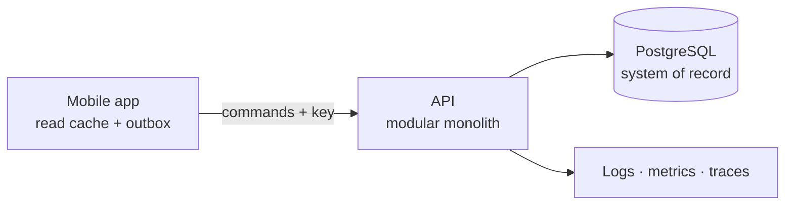

# Presentation Outline

**MAL 4 · Martech · Campaign Integrity**  
**Format:** 8 slides · 6 minutes · structured walkthrough (no prototype)  
**Goal:** Make the judges believe one sentence: *the campaign that gets scheduled is the campaign that was approved.*

---

## Before you start

- **Do not apologise for not having a prototype.** The brief says it is optional. Present the architecture as the deliverable it is.
- **Say what is simulated.** On slide 1 or 7: “This is a structured walkthrough. The logs are illustrative; the tests are specified, not executed.”
- **Keep one invariant on screen** for the technical slides. The judges should be able to repeat it back to you.
- **Rehearse the transitions.** The story is a sequence of state changes, not a feature list.

---

## Slide 1 — Title and promise

**Time:** 0:00–0:20

**On screen**

> # Campaign Integrity
> ### The campaign that gets scheduled is the campaign that was approved.
>
> Martech · MAL 4 · 1 November 2026
>
> Architecture-first submission · structured walkthrough · no prototype

**Speaker notes**

> “Every marketing team has an approval button. Very few can prove that the thing they scheduled is the thing that was approved. We built the architecture that makes that proof possible.”

**Transition:** “Let me show you the failure we are designing against.”

---

## Slide 2 — The risk: approval is detached from content

**Time:** 0:20–1:05

**On screen**

```
₹5,00,000 campaign  →  Reviewer approves  →  Marketer changes budget to ₹8,00,000
                                              ↓
                                     Dashboard still says
                                          APPROVED
                                              ↓
                                     Someone schedules it
```

> **The approval was real. It was for content that no longer exists.**

**Speaker notes**

> “This is not a missing status. The status is there. The problem is that it is attached to the campaign row, not to the content the reviewer actually saw.
>
> A reviewer approves a ₹5 lakh proposal. The budget becomes ₹8 lakh. The badge stays green. The schedule button still works. No error is shown, because no component knows that the approval and the content have separated.
>
> That is the bug we are designing out.”

**Transition:** “So we made the approval name the content.”

---

## Slide 3 — Scope, users, and the core journey

**Time:** 1:05–1:50

**On screen**

| Role | Job | Cannot |
|---|---|---|
| Marketer | Create, revise, submit, schedule | Approve any campaign |
| Reviewer | Approve or request changes on the current revision; may author own campaign | Approve a campaign they created; edit submitted content |
| System | Enforce transitions, bind decisions, audit, recover | Treat a timeout as success |

```
Create → Submit → Review → Request changes → Revise → Resubmit
       → Approve current revision → Schedule → Track history
```

**In scope:** proposals, revisions, decisions, scheduling eligibility, audit, recovery.  
**Out of scope:** ad publishing, creative assets, payments, analytics, notifications, offline authorisation.

**Speaker notes**

> “We deliberately kept the product small. Two roles, five revision states, one schedule per campaign. No ad-platform integration, no creative asset pipeline, no payments.
>
> The scope is not the interesting part. The interesting part is the moment after approval, when the marketer changes the budget or audience. That is where the architecture earns its keep.”

**Transition:** “Here is the shape of the system.”

---

## Slide 4 — High-level design: one authority, one invariant

**Time:** 1:50–2:35

**On screen**



**Three lines**

1. **PostgreSQL is the source of truth.** The mobile database is a cache plus a queue of intentions.
2. **Approval eligibility is derived**, never stored as a boolean.
3. **The server checks current revision + decision + hash + active schedule in one transaction.**

**Speaker notes**

> “The mobile app caches reads and queues commands. It never decides that a campaign is approved.
>
> The server is a modular monolith, not microservices. That is a deliberate choice: the guarantee needs one transaction, not a distributed saga.
>
> There is no `is_approved` column. Approval is computed from the current revision and the decision. A derived value cannot drift out of date; a stored boolean can.”

**Transition:** “The critical feature is the scheduling check.”

---

## Slide 5 — The critical feature: revision-bound scheduling

**Time:** 2:35–3:35

**On screen**

```
active_schedule(c)
  ⇒ current_revision(c).state = APPROVED
  ∧ decision.revision_id       = current_revision(c).id
  ∧ decision.content_hash      = current_revision(c).content_hash
```

```
BEGIN
  lock campaign
  if requested revision ≠ current        → 409 REVISION_STALE
  if current state ≠ APPROVED            → 409 APPROVAL_INVALID
  if decision.hash ≠ revision.hash       → 409 CONTENT_HASH_MISMATCH
  if active schedule exists              → 409 ALREADY_SCHEDULED
  insert schedule + audit + idempotency response
COMMIT
```

**Speaker notes**

> “This is the whole product in one transaction.
>
> The client sends the revision ID and the content hash it saw. The server locks the campaign row, then checks four things: is this the current revision, is it approved, does the approval match the content, and is there already a schedule?
>
> If any check fails, the transaction rolls back and the client gets a specific conflict. If all pass, the schedule, the audit event, and the idempotency response commit together.
>
> The row lock is what makes the check-and-act atomic. Without it, an edit could slip between the check and the insert.”

**Demo sequence (structured walkthrough)**

> “Let me walk the state machine. Create revision 1, submit, request changes, revise to revision 2, approve, schedule. Now change the budget: revision 3 is created, revision 2 is superseded, and the schedule is cancelled in the same transaction. Try to schedule revision 2: `REVISION_STALE`. Edit revision 3 to create revision 4, approve revision 4, and schedule it. That is the end-to-end journey.”

**Transition:** “The interesting part is what happens when the network fails.”

---

## Slide 6 — Failure and recovery: a timeout is not a failure

**Time:** 3:35–4:35

**On screen**

```
11:32:02  server commits DEC-9003
11:32:02  response lost
11:32:03  app shows “Confirming approval…”
11:33:10  retry with the same key
11:33:10  server replays the stored response
          → one decision, one audit event
```

**Failure scenarios**

| Failure | Detection | Recovery |
|---|---|---|
| Reviewer acts on a stale revision | Current-revision check under lock | `409 REVISION_STALE`; no decision; refresh |
| Response lost after commit | Client timeout | Replay by idempotency key; no duplicate |
| App killed after send, before response | Outbox `IN_FLIGHT` | `GET /commands/:key`, then resend or apply |
| Two schedule requests race | Row lock + partial unique index | One `201`, one `409` |

**Speaker notes**

> “The dangerous failure is not the request that never arrived. It is the request that committed and whose response was lost.
>
> The client cannot tell the difference between ‘the server never got it’ and ‘the server committed and the reply vanished’. So it does not guess. It shows ‘Confirming…’, keeps the intent in an outbox, and retries with the same idempotency key.
>
> The server has already stored the response against that key. The retry is a replay, not a second approval. One decision, one audit event.
>
> The stale-revision case is the other half. The reviewer taps approve on revision 3 after revision 4 is current. The server returns a conflict and writes nothing. The user sees what changed.
>
> A timeout is not evidence of failure. A conflict is not a silent success.”

**Transition:** “How would we know this actually works?”

---

## Slide 7 — Verification and diagnostics

**Time:** 4:35–5:20

**On screen**

| Evidence | What it proves |
|---|---|
| Domain tests T-02…T-06 | The eligibility predicate and hash are correct |
| Integration T-07…T-12 | The transaction and constraints hold under concurrency |
| Recovery T-19…T-21 | Lost response, restart, duplicate tap |
| Invariant query | No active schedule without a current approved matching revision |
| Audit query | Every decision has an event; every event has a request ID |
| Metrics | Rejections by code, replay rate, outbox age, integrity violations |

> **Status:** tests specified, not executed. Logs illustrative. No prototype claimed.

**Speaker notes**

> “We are explicit about the evidence line. We have not run these tests. What we have is a test matrix that maps to the invariant, and a diagnostic design that would let us investigate a failure.
>
> The invariant query is the one I would run first: it returns zero rows, or the design is broken.
>
> The audit query is the second: every decision has an event, and every event has a request ID. If state and audit disagree, we fail closed.
>
> The metrics are chosen for the failure modes, not for vanity: schedule rejections by code, idempotent replay rate, and the age of pending outbox rows.”

**Transition:** “Finally, what happens when the business changes the rule?”

---

## Slide 8 — Change and close: dual approval

**Time:** 5:20–6:00

**On screen**

> **New rule:** campaigns above ₹1,00,000 need two distinct approvals.

| Changes | Stays |
|---|---|
| Policy snapshot on the revision | Immutable revisions |
| Multiple approvals per revision | Revision + hash binding |
| `schedule_approvals` join table | One active schedule |
| `approvalProgress` in the API | Idempotency and audit |
| “1 of 2” in the UI | Server as source of truth |

> **~2 days of work. No microservices. No workflow engine. No rewrite.**

**Closing**

> **Small enough to finish. Explicit enough to defend.**

**Speaker notes**

> “A realistic next rule is dual approval above a spend threshold. Imagine revision 4 — ₹8 lakh — were submitted under the new rule. One approval would not be enough.
>
> The revision model already supports multiple decisions; we drop the single-approval index, snapshot the policy at submission, count distinct reviewers, and record the approval set on the schedule. The API grows an `approvalProgress` field. The mobile shows ‘1 of 2’.
>
> What does not change is the important part: the approval still names the revision and the hash; the schedule still checks the current revision; retries are still idempotent; the audit still commits with the state.
>
> That is the test of the architecture: a new rule changes a policy, not the foundation.
>
> The campaign that gets scheduled is the campaign that was approved — by enough people.”

---

## Timing summary

| Slide | Topic | Duration | Cumulative |
|---|---|---|---|
| 1 | Title and promise | 0:20 | 0:20 |
| 2 | The risk | 0:45 | 1:05 |
| 3 | Scope and journey | 0:45 | 1:50 |
| 4 | High-level design | 0:45 | 2:35 |
| 5 | Critical feature | 1:00 | 3:35 |
| 6 | Failure and recovery | 1:00 | 4:35 |
| 7 | Verification | 0:45 | 5:20 |
| 8 | Change and close | 0:40 | 6:00 |

Leave 30 seconds of buffer. If the judges ask for a deeper walkthrough, use [`08-walkthrough-script.md`](08-walkthrough-script.md) and the Q&A in [`09-judge-qa.md`](09-judge-qa.md).

---

## Scorecard mapping

| Judging criterion | Weight | Where it is addressed | One line to say |
|---|---|---|---|
| Problem framing and scope | 10% | Slide 2–3; `01-solution-brief.md` | “The problem is detached approval, not a missing status.” |
| Structure and boundaries | 15% | Slide 4; `02-high-level-design.md` | “One authority, one transaction, pure domain.” |
| Data and state management | 15% | Slide 5; `03-low-level-design.md` | “Approval is derived; the revision and hash are the data model.” |
| Failure and recovery | 10% | Slide 6; `05-walkthroughs/failure-and-recovery.md` | “A timeout is not evidence of failure.” |
| Trade-offs and adaptability | 10% | Slide 8; ADRs; change walkthrough | “Dual approval changes a policy, not the foundation.” |
| Verification and observability | 15% | Slide 7; `06-verification-and-diagnostics.md` | “The invariant query returns zero rows, or the design is broken.” |
| Core user journey | 15% | Slide 3, 5; `05-walkthroughs/core-journey.md` | “Create, review, approve, schedule, edit, re-review.” |
| Architecture defence | 10% | Q&A; `09-judge-qa.md` | “Here is what we did not verify, and here is how we would.” |

---

## If you have only 60 seconds

> “An approval is a claim about content, not a status on a campaign. We bind every approval to an immutable revision and a content hash. Scheduling is one transaction that checks the current revision, the approval, the hash, and the active schedule. If anything is stale, it fails closed. Retries are idempotent, so a lost response never creates a second approval. The design is small — a modular monolith, two roles, three ADRs — and it absorbs dual approval without a rewrite.”
